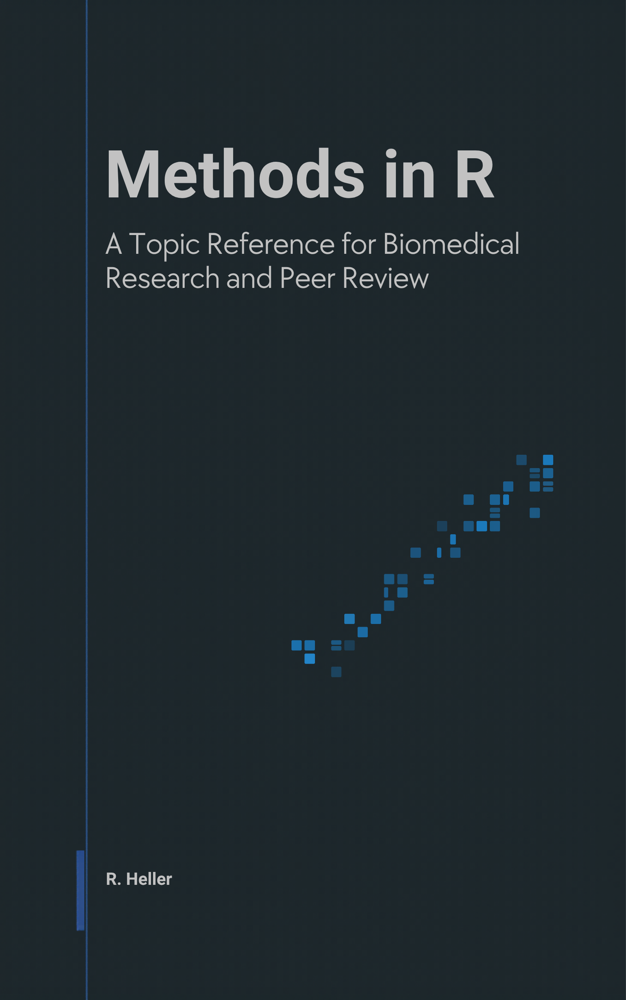

<p align="center">
  <a href="https://cttir.github.io/methods-in-r/">
    
  </a>
</p>

# Methods in R

*A topic reference for biomedical research and peer review.*

A free, open-source book by **Raban Heller**.

## Read it online

📖 **<https://cttir.github.io/methods-in-r/>**

## Download

Check the reading site for available PDF and EPUB downloads.

Download links in a built site appear only for files that build produced. PDF and
EPUB generation are separate from the HTML build; failed optional formats are
not advertised as available.

## What this book covers

The R/biostatistics shelf has plenty of linear textbooks. This one is shaped
for two readers it expects to serve in the same week: the **author** who has
data in front of them and needs to pick a method, run it in R, and write the
Methods paragraph; and the **peer reviewer** who has a manuscript on their
desk and needs to know — for the method the authors used — what a competent
application looks like, which diagnostics should have been reported, and what
red flags to flag.

Each method page links its *For Reviewers* section to a shared review checklist
and the method's assumptions or theory, plus practical tips. The original 569 reviewer
sections were empty templates; detailed method-specific reviewer notes remain
editorial work. The final *Reporting Templates* part supplies drafts tagged with
**STROBE / CONSORT / TRIPOD-AI / PRISMA / ARRIVE**, to adapt to the actual study.

The book covers 16 topic areas — from foundations and inference through
regression, survival, Bayesian methods, machine learning, bioinformatics, and
study design — with hands-on labs that consolidate the methods of each area
into a single runnable file.

## Sources consolidated

- [`CTTIR/courses`](https://github.com/CTTIR/courses) — earlier lab
  materials that inspired the worked examples here. Re-homed by topic.
- [`CTTIR/tutorials`](https://github.com/CTTIR/tutorials) — earlier
  method pages written to a 9-section template; extended here with a
  10th section, *For Reviewers*.

Both source repositories are MIT-licensed and authored by R. Heller.

## How to cite

> Heller, R. (`2026`). *Methods in R: A Topic Reference for Biomedical
> Research and Peer Review.* <https://cttir.github.io/methods-in-r/>.

BibTeX:

```bibtex
@book{heller2026methods,
  author    = {Heller, Raban},
  title     = {Methods in R: A Topic Reference for Biomedical Research and Peer Review},
  year      = {2026},
  publisher = {Self-published via GitHub Pages},
  url       = {https://cttir.github.io/methods-in-r/}
}
```

## Reproducibility

The HTML is a **static reference**: rendering displays the examples without
executing every statistical analysis. The 80 lab scripts pass a syntax check;
the maintenance review executed the tidy-data and import/join labs. This is not
validation of all methods or a substitute for checking assumptions on your data.

Requirements: R, Pandoc, Python 3, and bookdown >= 0.47. A first HTML build:

```bash
git clone https://github.com/CTTIR/methods-in-r.git
cd methods-in-r
Rscript --vanilla -e 'install.packages(c("bookdown", "rmarkdown", "knitr", "bslib", "downlit", "xml2", "htmltools", "sessioninfo"), repos="https://cloud.r-project.org")'
python3 -m unittest discover -s tests
python3 scripts/check-lab-code.py
Rscript --vanilla -e 'bookdown::render_book("index.Rmd", output_format="bookdown::bs4_book")'
python3 scripts/build-download-manifest.py
python3 scripts/check-html-links.py docs /tmp/methods-links.json
python3 -m http.server 8000 --directory docs
```

Open <http://localhost:8000>. To restore the historical dependency snapshot,
install `renv` and run `renv::restore()` first; this review used current available
packages rather than qualifying that entire snapshot. EPUB uses
`bookdown::epub_book`; PDF uses `bookdown::pdf_book` and additionally requires
XeLaTeX/TinyTeX. To produce the verified EPUB path:

```bash
Rscript --vanilla -e 'bookdown::render_book("index.Rmd", output_format="bookdown::epub_book")'
python3 scripts/finalize-epub.py
python3 scripts/build-download-manifest.py
```

The EPUB finalizer repairs references after chapter splitting and embeds readable
BibTeX/RIS attachments. Run the download inventory after building extra formats.
See [MAINTENANCE.md](MAINTENANCE.md) for the measured scope and remaining work.

The decision tree is a checked-in SVG with editable source in
`images/decision-tree.mmd`. To regenerate it, install Playwright in a separate
authoring environment, install its Chromium browser, and run
`node scripts/render-decision-tree.cjs /path/to/quarto/share/formats/html/mermaid/mermaid.min.js`
with that environment on `NODE_PATH`. Normal book builds do not need Node or a browser.

## Sibling volume

This is the second book in the *…in R* series. The first is
[`CTTIR/strategy-in-r`](https://github.com/CTTIR/strategy-in-r) —
*Strategy in R: Game Theory, Simulation, and Machine Intelligence*.

## Use of LLM tools

Portions of this book were prepared with assistance from large language model tooling for
narrowly defined, non-authorial tasks: copyediting, prose smoothing, Markdown/LaTeX formatting,
scaffolding of boilerplate files (CI configs, build scripts), code refactoring. The tools used were [Chat AI](https://kisski.gwdg.de/leistungen/2-02-llm-service/),
the LLM service of KISSKI (GWDG), and a self-hosted **Mistral Small (24B, Apache-2.0)** run locally via
[Ollama](https://ollama.com/) and the `ollamar` R package — local inference only, with no data sent to
third parties for the self-hosted model.

All scientific claims, methodological choices, analyses, interpretations, and conclusions are the
author's own. No LLM-generated text was incorporated without review and revision, and every reference
was verified against its DOI, arXiv ID, or ISBN.

## License

The prose of this book is licensed under [CC BY 4.0](https://creativecommons.org/licenses/by/4.0/); all code (scripts, chunks, examples) is licensed under the [MIT License](LICENSE-CODE.md).

## Contributing

Issues and PRs welcome — see [CONTRIBUTING.md](CONTRIBUTING.md) or open an
issue at <https://github.com/CTTIR/methods-in-r/issues>.

## Validate a release build

Use Python 3 with `pypdf`, the book’s R dependencies, Pandoc and XeLaTeX.
Refresh the page notes before rendering; their dates follow source revisions,
not the day the site is built. Then validate the actual downloadable artifacts:

```sh
python3 scripts/update-page-provenance.py
Rscript -e 'bookdown::render_book("index.Rmd", output_format = "all")'
python3 scripts/finalize-epub.py
python3 scripts/build-download-manifest.py
python3 scripts/finalize-book.py
python3 scripts/check-book.py
```

The final check fails on missing author/date notes, broken local links or anchors,
missing or unreadable whole-book PDF/EPUB files, and LaTeX sources left in `docs/`
(delete `docs/*.tex` first; the LaTeX file is a build intermediate). CI then builds
and checks the chapter PDF and EPUB downloads in `docs/downloads/chapters/` with
`scripts/build-downloads-ci.sh`.
