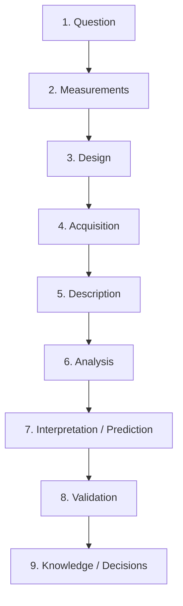

# The research workflow {#sec-appendices-a-research-workflow}

APPENDIX · RESEARCH WORKFLOW

Nine stages from a research question to knowledge that survives
replication.

Statistics is a thread running through a much longer process. The diagram
below names the stages of that process and links each to the parts of
the curriculum that cover it in detail. No stage is optional; errors
made at one are paid for at the next.

## 1. Question {#sec-appendices-a-research-workflow-1-question}

A well-formed research question has a population, an exposure or
intervention, a comparator, an outcome, and a time frame. The PICO
framework from evidence-based medicine is a useful checklist.
A vague question leads to a vague design and a vague answer; a
well-formed question survives peer review before a single datum is
collected.
*Covered in:* [Scientific process and research workflow](#sec-chapters-01-foundations-labs-lab-scientific-process-and-research-workflow),
[Systematic reviews and prisma](#sec-chapters-15-metaanalysis-labs-lab-systematic-reviews-and-prisma).

## 2. Measurements {#sec-appendices-a-research-workflow-2-measurements}

Every question depends on the measurement scale you choose to answer it.
Accuracy, precision, reliability, and the difference between a measurement
and a proxy are the vocabulary.
*Covered in:* [Data types tidy data accuracy and precision](#sec-chapters-01-foundations-labs-lab-data-types-tidy-data-accuracy-and-precision),
[Kappa icc bland altman](#sec-chapters-14-clinical-labs-lab-kappa-icc-bland-altman).

## 3. Design {#sec-appendices-a-research-workflow-3-design}

Design is where you choose what the data can and cannot tell you. A
well-designed observational study answers some questions better than a
badly designed RCT; a good RCT answers them all.
*Covered in:* [Observational designs and strobe](#sec-chapters-16-design-labs-lab-observational-designs-and-strobe).

## 4. Acquisition {#sec-appendices-a-research-workflow-4-acquisition}

Getting the data into a computer faithfully is itself a statistical
problem: missingness, measurement error, and batch effects start here.
*Covered in:* [Import joins and missingness with dplyr](#sec-chapters-01-foundations-labs-lab-import-joins-and-missingness-with-dplyr),
[Mcar mar mnar](#sec-chapters-16-design-labs-lab-mcar-mar-mnar).

## 5. Description {#sec-appendices-a-research-workflow-5-description}

Before any inference, look at the data. A well-designed plot is often
the whole answer.
*Covered in:* [Ggplot2 grammar and multi panel layouts](#sec-chapters-06-visualisation-labs-lab-ggplot2-grammar-and-multi-panel-layouts),
[Descriptive statistics and table 1](#sec-chapters-02-descriptives-labs-lab-descriptive-statistics-and-table-1).

## 6. Analysis {#sec-appendices-a-research-workflow-6-analysis}

The formal model that takes the data and returns an estimate, an
interval, and a decision.
*Covered in:* Courses 1–4, throughout.

## 7. Interpretation / prediction {#sec-appendices-a-research-workflow-7-interpretation-prediction}

What does the estimate mean in the scale of the science? Effect size,
clinical significance, and the distinction between an average and an
individual prediction live here.
*Covered in:* [Calibration discrimination roc auc brier score](#sec-chapters-07-regression-labs-lab-calibration-discrimination-roc-auc-brier-score),
[Time dependent brier ipa external validation](#sec-chapters-11-survival-labs-lab-time-dependent-brier-ipa-external-validation).

## 8. Validation {#sec-appendices-a-research-workflow-8-validation}

Does the finding hold in data not used to find it? External validation,
nested CV, and replication pool here.
*Covered in:* [Cross validation nested cv bootstrap 632](#sec-chapters-13-ml-labs-lab-cross-validation-nested-cv-bootstrap-632),
[Time dependent brier ipa external validation](#sec-chapters-11-survival-labs-lab-time-dependent-brier-ipa-external-validation).

## 9. Knowledge / decisions {#sec-appendices-a-research-workflow-9-knowledge-decisions}

The act of writing it down so that others can trust, cite, and build on
the finding.
*Covered in:* [Writing a report](#sec-appendices-d-writing-a-report),
[Explanation vs prediction reporting](#sec-reporting-lab-explanation-vs-prediction-reporting).
